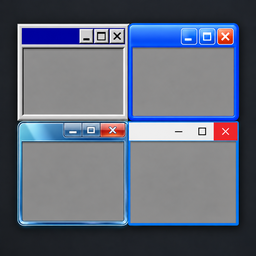

<p align="center">
  
</p>

# WinMim — Windows Mimicry

WinMim is an experimental Windows customization toolkit that aims to recreate the appearance **and behavior** of historical Windows desktops.

[Status](#project-status) · [Build](#building-from-source) · [Contributing](CONTRIBUTING.md) · [Roadmap](docs/DEVELOPMENT.md) · [Upstream research](docs/OPEN-SOURCE-LANDSCAPE.md) · [License](LICENSE)

## Project status

**Developer preview, version 0.1.0.** WinMim does not yet match Revert8Plus feature for feature, and does not provide an indistinguishable recreation of any Windows release.

The current integration target is **Windows 10 IoT Enterprise LTSC 2021, x64, build 19044**. Full desktop operations are deliberately restricted to the prepared `AEROFORGE-LAB` virtual machine. General installation on other machines is not implemented.

| Target appearance | Current implementation |
| --- | --- |
| Windows 95 | Experimental native classic rendering, palette and metrics, Open-Shell menu, desktop icons and Explorer/taskbar modules. Apply/restore and controlled resume/restore after reboot tested; normal startup still requires elevation. |
| Windows 7 | Experimental desktop coordinator, Explorer behavior, taskbar properties, icons and optional components in the private lab. Some required visual resources are external and are not in this repository. |
| Windows Vista | Module preset; complete desktop conversion is pending. |
| Windows 98, Me, 2000, XP, 8, 8.1, 10, 11 | Catalog entries and future targets. Selecting them does not apply a theme. |

Long term, WinMim will support multiple target appearances on Windows 10 and Windows 11. This is a roadmap, not a compatibility claim. Windows 11 integration is not validated yet.

## Features

- A Windows Forms control panel using system controls, colors and fonts, with a Russian interface.
- Profile planning, module configuration, JSON import/export and separate engine start/stop controls.
- Journaled changes with backups written before mutation, failure recovery and conflict-aware rollback.
- A pinned Windhawk runtime and module collection: 39 catalog modules and 56 compiled x86/x64 module DLLs in the prepared build.
- A Windows 7 lab coordinator for Open-Shell, visual styles, Aero Glass, desktop resources and classic shell behavior.
- A Windows 95 lab profile with native classic drawing, compact menus, a teal desktop and 3D taskbar controls.
- Standalone Mines, notes, memory/clock gadgets, a local media player and window switcher.
- A CLI for diagnostics, verification, planning, staging and recovery.

Choosing a catalog entry does not change Windows. External dependency installers are separate operations and are not covered by profile rollback.

## Requirements

To run a prepared build:

- Windows x64 and the **.NET 10 Desktop Runtime**.
- A disposable Windows 10 LTSC 2021 VM with a recovery snapshot for full desktop experiments.
- Internet access for optional dependency downloads and first-time Windows symbol resolution, or a prepared local cache.

Some lab operations require administrator rights and an Explorer restart. Runtime compatibility depends on the exact Windows build and update revision, selected modules and third-party components.

## Building from source

Install **.NET SDK 10**, **Python 3.10+** and **7-Zip**. C# projects use no external NuGet packages. Run from the repository root in PowerShell:

```powershell
python -m pip install -r requirements-dev.txt
.\tools\build.ps1 -PrepareNative
```

The first build downloads the pinned official Windhawk offline package, verifies its SHA-256, extracts its compiler/runtime using 7-Zip, and compiles the module sources. The installer is not executed. Generated runtime files, native DLLs, build output and caches are excluded from Git.

For later C# changes, after native preparation:

```powershell
.\tools\build.ps1
```

| Output | Purpose |
| --- | --- |
| `build/app/WinMim.exe` | Desktop application |
| `build/cli/AeroForge.Cli.exe` | Command-line controller |
| `content/catalog.json` | Component metadata and integrity manifest |

Internal `AeroForge` namespaces and state directory names are retained for compatibility with existing recovery journals.

## Running and validation

```powershell
.\build\app\WinMim.exe
.\build\cli\AeroForge.Cli.exe diagnose
.\build\cli\AeroForge.Cli.exe verify --content .\content
.\build\cli\AeroForge.Cli.exe plan --content .\content --profile seven
```

Launching the control panel alone does not apply a profile. Inspect the plan before using the explicit apply/start actions. Complete Windows 7 and Windows 95 integration actions currently require the lab environment and its separately prepared dependencies.

Validation after native preparation:

```powershell
.\tools\build.ps1
python -m unittest discover -s tests -p 'test_*.py'
python tools/verify_native.py
.\tools\smoke.ps1 -ScratchDirectory C:\Temp\WinMim-New-Smoke-Directory
```

Choose a new, nonexistent scratch directory. The smoke check stages and rolls back files there without starting the engine or applying a system theme. The current local baseline is **56 Core tests, 9 Python tests and 56 verified native DLLs**. Compilation and automated tests do not establish visual fidelity or compatibility after reboot.

## Recovery and limitations

Use the application's recovery page or matching profile restore action. Stop the engine before rolling back its files. Restore changes in reverse order. If a value was changed by another program after WinMim applied it, rollback preserves that change and reports a conflict.

Keep a VM snapshot in addition to WinMim's journals. A journal cannot recover an unbootable guest, remove every effect of an external installer, or undo changes outside its recorded scope. Windows 95 passed a controlled reboot/resume/restore test after the [reliability fixes](docs/CLASSIC95-BUGFIXES-20261029.md). This does not establish unattended startup or fully explain the original black-screen incident.

The lab was recovered to its Seven snapshot, updated and successfully rebooted. See the [recovery report](docs/VM-RECOVERY-20261029.md) and subsequent [UI, resource and performance fixes](docs/CLASSIC95-RELIABILITY-20261030.md) for observations and limits.

Remaining gaps include complete historical icons and cursors, Explorer content and commands, tray details, system dialogs, modern app surfaces, logon screens and consistent behavior across Windows updates. See [development priorities](docs/DEVELOPMENT.md) and the [Windows 7 gap list](docs/WIN7-VISUAL-GAPS.md).

## Repository layout

```text
src/AeroForge.Core/   Planning, adapters, journals, rollback and shell host
src/AeroForge.App/    Native control panel and standalone utilities
src/AeroForge.Cli/    Diagnostics and command-line operations
src/WinMim.Native/    Original shell integration modules
vendor/windhawk-mods/ Pinned upstream module sources and source manifests
content/classic95/   Licensed homage artwork and provenance
assets/branding/     Project icon in PNG and multi-resolution ICO formats
tools/               Dependency preparation, builds, verification and packaging
tests/               Core, tool and lab test programs
docs/                Architecture, implementation notes and research
```

Historical implementation notes are currently mostly in Russian. Raw lab captures, credentials, private resource packs and local session notes are excluded from Git.

## Contributing

Read [CONTRIBUTING.md](CONTRIBUTING.md). Useful contributions include reproducible VM bug reports, build-specific compatibility results, historical behavior comparisons, original artwork and isolated adapters with a tested restore path.

Report the exact Windows build/UBR, WinMim commit, profile, dependency versions, reproduction steps and expected/actual behavior. Remove account information and secrets from logs before sharing them.

## License and acknowledgments

Original WinMim code is licensed under **GPL-3.0**. Upstream modules and components retain their own licenses. See [THIRD-PARTY-NOTICES.md](THIRD-PARTY-NOTICES.md), [third-party.lock.json](third-party.lock.json) and original source headers.

WinMim builds on work by the Windhawk community, Open-Shell, SecureUxTheme, OpenGlass and the authors of the included classic homage artwork. The project icon was supplied by the maintainer.

Revert8Plus is a behavioral reference. Its installer, proprietary components and extracted Windows resource packs are not included. Optional private lab assets are not relicensed as WinMim source. Windows names and trademarks belong to Microsoft; WinMim is an independent project.
