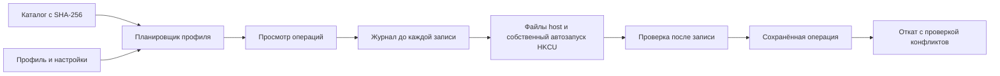

# Архитектура AeroForge 0.1

## Цепочка выполнения



Приложение не копирует старый установщик Revert8Plus. Его собственное ядро развертывает зафиксированные компоненты из каталога. Нативный движок — официальный portable Windhawk; исходники движка сохранены рядом с проектом. Компиляция модулей повторяет формат публичного ABI и флаги официального `compilerUtils.ts` версии 1.7.3.

## Хранилища

- `content/catalog.json`: модули, версии, авторы, лицензии, профили и SHA-256 каждого распространяемого бинарника.
- `%LOCALAPPDATA%\AeroForge\Host`: отдельный portable host, DLL и INI. Не использует HKLM-настройки существующего Windhawk.
- `%LOCALAPPDATA%\AeroForge\State`: журналы восстановления и блокировка одного писателя.
- `%LOCALAPPDATA%\AeroForge\Downloads`: проверенные загрузки дополнительных установщиков.
- `%LOCALAPPDATA%\AeroForge\Tools`: пользовательские заметки.

Идентификаторы модулей: `local@aeroforge-<upstream-id>`. Их исходники сохраняют оригинальные метаданные; управляемый ID задаётся определением `WH_MOD_ID` при компиляции. INI и файлы DLL относятся к тому же ID.

`windhawk.ini` включает portable mode. `Engine/1.7.3/engine.ini` лежит на один уровень выше `32/windhawk.dll` и `64/windhawk.dll`, как требует движок. Путь `AppDataPath=../../Data/Engine` вычисляется относительно каталога `engine.ini`.

Одновременный запуск второго Windhawk не поддерживается: portable экземпляры используют общие механизмы координации исходного движка. Приложение обнаруживает другой процесс и предлагает остановить его вручную. Наличие установленного, но не запущенного Windhawk не приводит к удалению его данных.

## Транзакции

Для каждой операции:

1. Проверяется допустимость назначения.
2. Читается исходное состояние. Для реестра сохраняются тип и нераскрытое значение, для файла — байты.
3. На диск атомарно записывается Pending-запись с ожидаемым отпечатком результата; поток принудительно сбрасывается.
4. Выполняется изменение и проверяется результат чтением.
5. В журнале операция отмечается Applied.

При ошибке или отмене откат проходит записи в обратном порядке, включая последнюю Pending-запись. Это покрывает сбой между фактической записью и подтверждением в журнале.

Если текущее значение совпадает с исходным — оно уже восстановлено. Если совпадает с нашим применённым значением — восстанавливается резервная копия. Если отличается от обоих — сохраняется без изменений и отмечается конфликт. Новые изменения блокируются до завершения восстановления. Операции откатываются от более поздней к ранней.

Журнал охватывает только перечисленные операции AeroForge. Установщики Open-Shell/OpenGlass/SecureUxTheme, пользовательские изменения в приложениях и внутренние runtime-кэши движка не выдаются за часть этой транзакции. Откат не гарантирует удаление произвольных файлов, созданных движком во время работы.

## Ограничение полномочий

Файловые пути должны находиться под заданным корнем. Запрещены `..`, абсолютные назначения, NTFS alternate streams, зарезервированные имена Windows и reparse points в назначении и его предках. Запись файлов выполняется через новый временный файл и замену, а не через перезапись существующего inode.

Реестр ограничен собственной записью AeroForge в HKCU Run и предусмотренной областью настроек Open-Shell. HKLM, Windows, Program Files, изменение ACL и исключения Defender адаптером не поддерживаются. Процесс host не запускается с повышенными правами из интерфейса.

Модули с целями `dwm.exe`, `winlogon.exe`, `logonui.exe`, `consent.exe` отмечены как системные и заблокированы обычным планом. CLI имеет отдельный разработческий `--allow-critical`, но это не повышает права portable host и не подтверждает совместимость.

## Самостоятельные инструменты

- Alt+Tab написан заново на C#/Win32. Обработчик клавиатуры включается только флажком пользователя, не записывает клавиши и отключается при закрытии окна. В сборке не используется модуль ClassicWindowSwitcher под GPL-2.0.
- Медиатека использует WPF MediaElement и установленные кодеки Windows. Это локальный плеер, без ТВ, DRM и записи эфира.
- Сапёр имеет отдельную тестируемую модель; первый ход и соседние клетки гарантированно свободны от мин.
- Заметки сохраняются только после редактирования, локально при закрытии окна.

## Формат профиля

```json
{
  "id": "my-seven",
  "name": "Мой Seven",
  "description": "Профиль оболочки",
  "accent": "#69BCEF",
  "modules": ["aerexplorer", "win32-tray-clock-experience"],
  "settings": {"aerexplorer": {"smalladdress": "1"}}
}
```

Accent задаёт цвет эскиза в интерфейсе; он пока не применяется как визуальная тема Windows. Настройки модулей превращаются в INI Settings. Импорт не допускает неизвестные ID, а генератор INI отвергает внедрение переводов строк. После импорта профиль существует в памяти приложения; для повторного использования сохраните его через экспорт.
