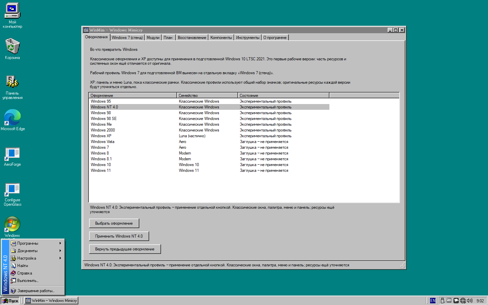
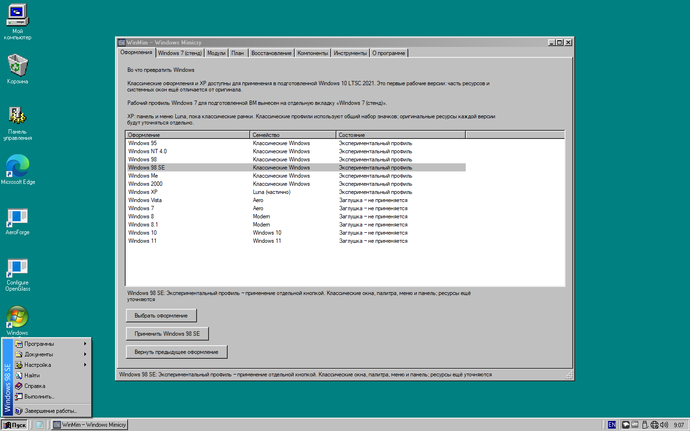
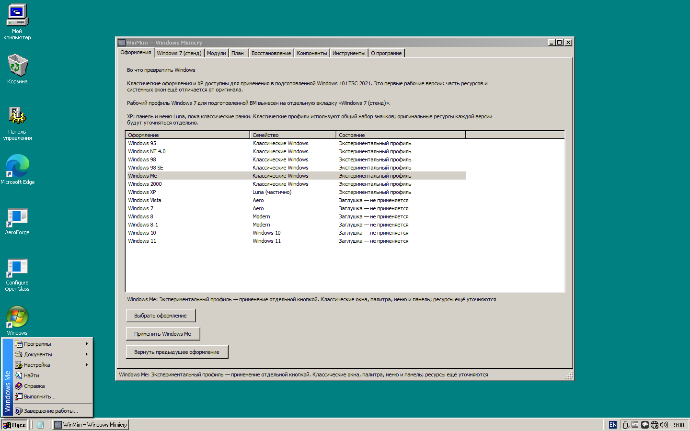
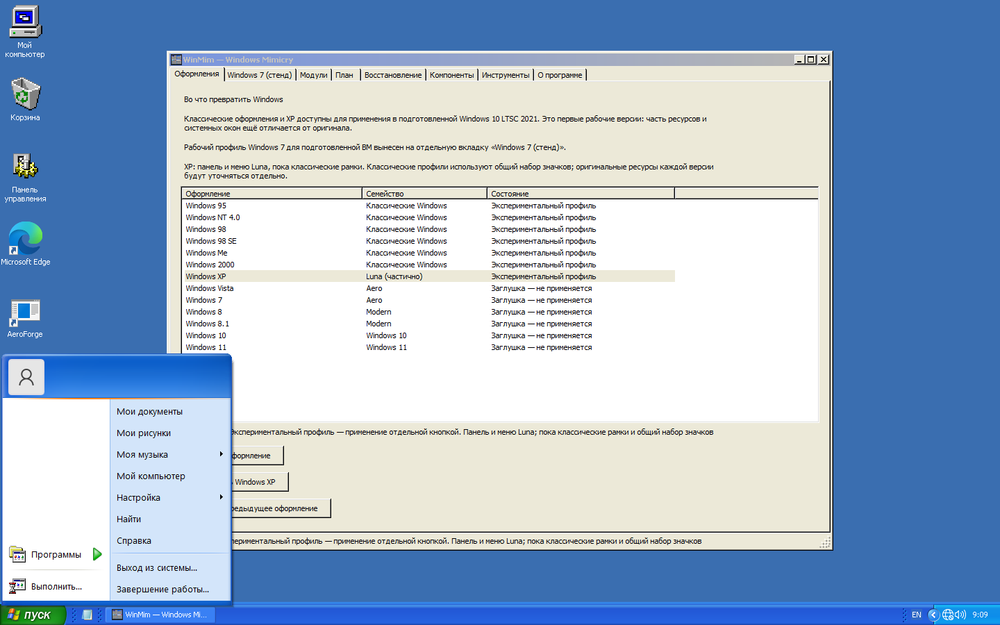

# Первые рабочие классические профили и XP

30 октября 2026. По новому запросу пользователя XP включена в реализацию; прежнее решение отложить её отменено. Windows 1.x–3.x и NT 3.x не реализовывались.

В каталоге теперь 13 оформлений. Семь классических/XP-профилей реально применяются отдельной кнопкой: 95, NT 4.0, 98, 98 SE, Me, 2000, XP. Seven сохраняет отдельный рабочий сценарий. Выбор строки по-прежнему не изменяет ОС.

## Что применяется

| Профиль | Панель | Отличия базового оформления |
| --- | --- | --- |
| 95 | Штатная классическая панель с существующими модулями | MS Sans Serif, бирюзовый фон, одноцветные заголовки, меню 95 |
| NT 4.0 | RetroBar Windows 95-98 | Классическая палитра, меню и подпись NT 4.0; без Quick Launch |
| 98 / 98 SE | RetroBar Windows 95-98 | Градиент заголовков, Quick Launch, «Избранное», отдельные подписи профиля |
| Me | RetroBar Windows Me | Tahoma, более светлая палитра контролов, градиенты, Quick Launch |
| 2000 | RetroBar Windows 2000 | Tahoma, синеватый фон, светлая палитра и классические заголовки с градиентом |
| XP | RetroBar Windows XP Blue | Синяя панель/зелёная кнопка Start, двухколоночное меню Open-Shell Windows XP Luna, Tahoma и другая палитра |

Это рабочая основа с ограниченной точностью. NT 4.0 и 98/SE намеренно переиспользуют похожую панель, а не получают выдуманный отдельный рисунок. Пока используется общий набор значков; при наличии личного оригинального набора 95 он сохраняется. Точный ресурсный дифф каждой системы остаётся задачей. **XP пока использует классические рамки и контролы, а не полноценные окна Luna.** Поиск, свойства и некоторые диалоги остаются современными. Не заявляется полная идентичность историческим ОС.

## Реализация и возврат

`ClassicThemes` задаёт данные профиля. `Classic95Profile` и `ClassicAppearance` используют их для реального плана палитры, метрик, меню и ресурсов. Существующие каталоги и идентификатор журнала 95 сохранены для совместимости.

Новые панели предоставляет неизменённый [RetroBar v1.22.122](https://github.com/dremin/RetroBar/tree/cff7a787c35c5f3e1db67a22a93721b911313fae). Подготовка закреплена по SHA-256 в `tools/fetch_classic_runtime.py` и `third-party.lock.json`; бинарник, исходный архив и уведомления проверяются отдельно. Из Git бинарники исключены, в portable-сборку включены. Рендеринг рамок и прочие модули WinMim не внедряются в процесс RetroBar.

Параметры RetroBar журналируются по отдельным JSON-полям. Его дополнительные поля и форматирование не мешают возврату; изменённые пользователем настройки сохраняются. Отдельный ранее запущенный RetroBar не завершается: применение сообщает о конфликте. WinMim управляет только своей копией.

При переходе на другую тему сначала возвращается предыдущий классический профиль, затем сохраняется исходное состояние для нового. Межпроцессная блокировка не допускает одновременного применения/возврата/возобновления из нескольких окон и CLI. Возврат останавливает свою панель и перезапускает Explorer, чтобы штатная панель снова появилась.

Обычное возобновление после входа всё ещё требует привилегированной фазы классического режима. Проверки новых профилей ниже не означают, что для каждого уже пройден отдельный холодный старт. Текущий проверенный хост — Windows 10 LTSC 2021 x64, build 19044.

CLI:

```powershell
.\build\cli\AeroForge.Cli.exe classic-inspect
.\build\cli\AeroForge.Cli.exe classic-apply --target windows-xp --content .\content --accept-experimental
.\build\cli\AeroForge.Cli.exe classic-restore --content .\content --accept-experimental
```

Старые команды `windows95-apply/restore/inspect` сохранены. Новый интерфейс явно подписывает неполную XP и общие ресурсы.

## Проверки

60 Core-тестов и 9 Python-тестов прошли. Новое покрытие: настоящие планы всех семи профилей, различия палитры/шрифтов/заголовков/XP-меню, допустимые настройки, отсутствие повторяющихся целей, JSON-журнал RetroBar и сохранение пользовательской правки.

В отдельной ВМ последовательный цикл для всех семи профилей проверил применённый идентификатор, нативное состояние, единственный процесс панели и выбранную тему RetroBar, затем отсутствие активного профиля/RetroBar и возврат исходного нативного оформления. Ошибок в первом полном цикле не обнаружено. Подготовка снимков выполнялась штатной командой открытия меню Open-Shell; реальный клик по Start и все пункты меню этим тестом не подтверждаются.

После добавления блокировки операций и исправления атомарной записи повторно проверены затронутые пути. Отдельный прямой переход XP → 98 → исходное оформление прошёл: выбран правильный профиль, исходное нативное состояние восстановилось. Финальная сборка установлена на основной тестовой системе; хеши приложения, Core и каталога совпали, проверка контента завершилась с кодом 0.

## Снимки

Реальные снимки первых реализаций с открытым меню, без композиции и макетов:

| NT 4.0 | 98 |
| --- | --- |
|  |  |

| 98 SE | Me |
| --- | --- |
|  |  |

| 2000 | XP |
| --- | --- |
|  |  |

Далее: точные ресурсы каждого поколения, Explorer/диалоги, полноценная Luna для окон XP, реальные переходы с панели, DPI и повторный вход. Исторический [план классических версий](CLASSIC-PRE-XP-PLAN.md) остаётся перечнем дальнейшей точности, а не описанием уже завершённых функций.
