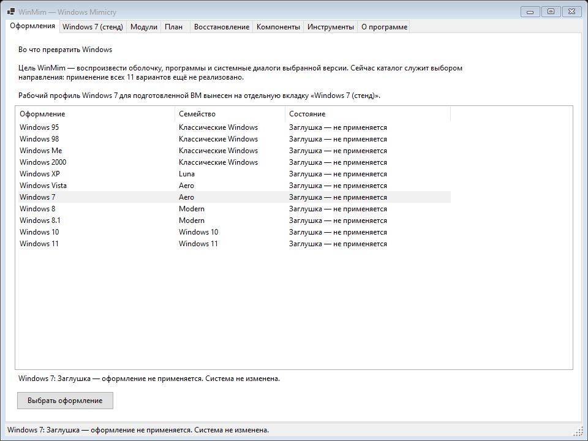
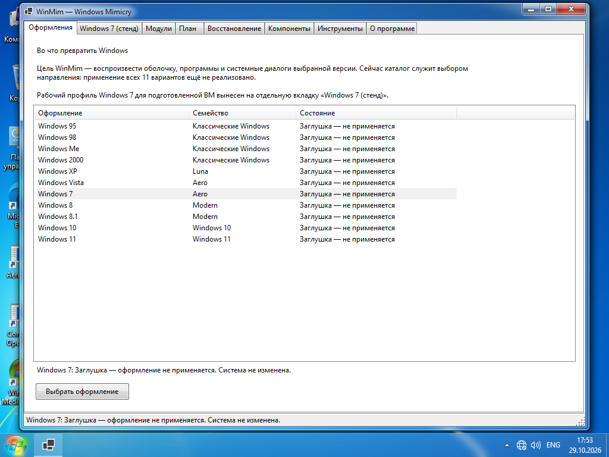

# WinMim: системный интерфейс и каталог оформлений

29 октября 2026. Обновление требований пользователя реализовано отдельно от рабочих shell-профилей.

## Каталог

11 самостоятельных вариантов: Windows 95, Windows 98, Windows Me, Windows 2000, Windows XP, Windows Vista, Windows 7, Windows 8, Windows 8.1, Windows 10, Windows 11.

**Все варианты каталога — заглушки.** Выбор, двойной щелчок и кнопка «Выбрать оформление» только обновляют текст в окне. Нет вызова планировщика, записи настроек, запуска модулей, загрузки или применения темы. Windows 8 и 8.1, а также 95/98/Me/2000 представлены раздельно.

Долгосрочная цель: воспроизводить не только цвета/рамки, а весь внешний вид и наблюдаемое поведение оболочки и системных областей. Наличие пункта в каталоге не означает поддержку исходной ОС Windows 95/XP в качестве платформы запуска.

Уже работающая экспериментальная интеграция Windows 7 на Windows 10 LTSC 2021 сохранена на отдельной вкладке «Windows 7 (стенд)». Там применение — явное отдельное действие после проверки готовности; каталог её не запускает.

## Системный интерфейс

Основное окно переведено с WPF на Windows Forms. Используются стандартные вкладки, списки, кнопки с FlatStyle.System, системные шрифт и цвета. EnableVisualStyles включён, OwnerDraw отсутствует. Нет брендовой палитры, градиентов, скруглённых карточек, скрытых вкладок, принудительного Segoe UI и собственной имитации рабочего стола. Параметры модуля и резервные свойства панели задач также перенесены на WinForms. Остаточные самостоятельные WPF-инструменты используют системные ресурсы вместо глобальных шаблонов WinMim; семантические цвета видео и игрового поля сохранены.

Сохранены функции управления модулями, редактирования параметров, импорта/экспорта, просмотра плана, подготовки и запуска движка, восстановления, компонентов, диагностики и запуска классических программ. Раздел восстановления показывает прежние журналы, технические каталоги AeroForge не переименованы.

## Следующая функция r8p: звуки Windows 7

Добавлен отдельный компонент для стенда: 25 событий Windows/Explorer, 24 различных исходных WAV. При применении проверяются фиксированные SHA-256 и заголовки RIFF/WAVE. Программа ссылается на внешний проверенный пакет в PrivateAssets; системные звуковые файлы не заменяются. Реестр меняется только у текущего пользователя и только для определённых значений событий `.Current`.

Есть отдельные действия «Применить звуки» / «Вернуть звуки», CLI sounds-apply / sounds-restore с --accept-experimental, sounds-history. Повторное применение сохраняет первоначальную точку возврата, поздние изменения пользователя защищены конфликтом. Пакет WAV не включён в исходники и portable ZIP.

Назначение файла событию не означает, что Windows 10 начнёт вызывать отключённые ею события входа/выхода. Отдельная эмуляция этих событий пока не реализована.

## Проверки

47 Core-тестов, 8 Python-тестов; локальный UI smoke выбирает все 11 пунктов и проверяет отсутствие операций. Снимки всех восьми вкладок проверены; исправлены перенос текста и перекрытие заголовков компонентов. Результаты проверок в ВМ сохраняются отдельно в evidence.

## Дальше

Продолжить список соответствия r8p: точность системных окон, вход/UAC, детали оболочки, работа гаджетов и медиакомпонентов. Довести возврат DVD-зависимости. Реализовывать новые исторические оформления только последующими этапами — нынешние пункты остаются заглушками.

### Результат испытания в основной ВМ

- Native UI smoke: Windows Forms, VisualStyles=true, OwnerDraw=false, кнопки System, 8 вкладок; все 11 выборов возвращают ChangesSystem=false и 0 операций.
- Звуки: 25 событий, 0 подменённых/скопированных системных файлов; повторное применение идемпотентно. Искусственно внесённое чужое значение сохранено с RollbackIncomplete; после удаления собственного тестового маркера возврат RolledBack и exact=true. failures=0.
- Ранняя тестовая операция восстановлена по своему журналу, failures=0. Старый тест ошибался при очистке собственного маркера; исправлен сам тест. Это не потеря пользовательского значения в рабочем применении.
- Приложение оставлено открытым в основной ВМ. Глобальное оформление в ходе проверки заглушек не применялось; звуковой тест вернул первоначальные значения.

