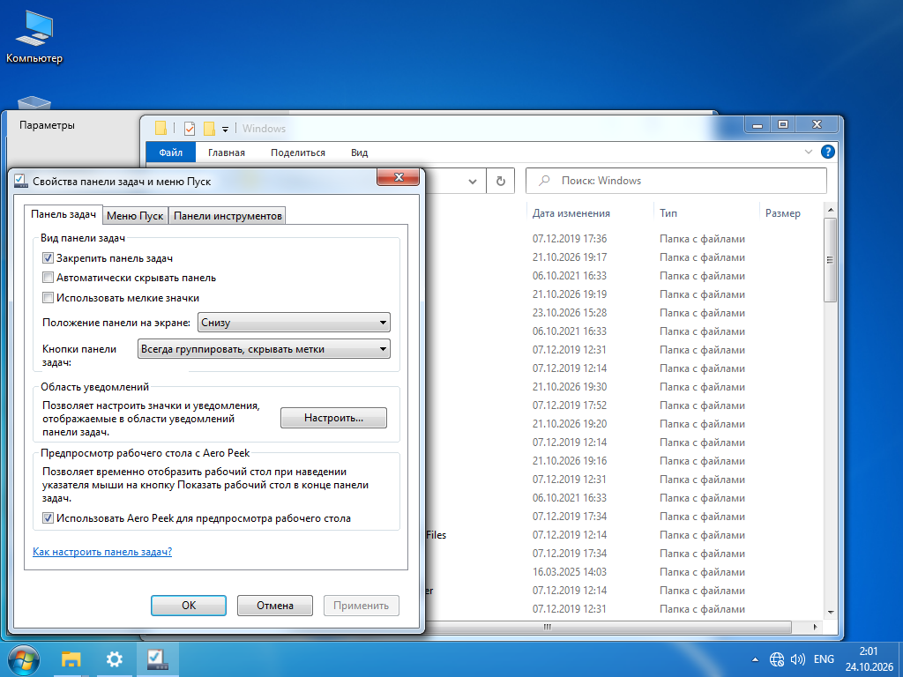

# Seven: поведение оболочки, 24 октября 2026

**Актуальная проверенная точка:** [полные значки, классический Проводник и нативные компоненты, 24.10](SEVEN-PROGRESS-20261024.md). Описания ниже, противоречащие этому обновлению, относятся к более ранним сборкам.

Цель — Windows 10 IoT Enterprise LTSC 2021 x64 → Windows 7. Полное соответствие Revert8Plus ещё не достигнуто. Изменения испытываются в AEROFORGE-LAB.

## Изменения

- Семь дополнительных модулей из того же upstream commit: свойства панели задач, переходы в панель управления, сеть, «Открыть с помощью», устаревшие апплеты, центр поддержки и «Экран». Точные Git blob SHA находятся в `vendor/windhawk-mods/ADDITIONAL-SOURCES.json`.
- В свойствах панели настройка «Пуска» направлена в Open-Shell; выбор действия завершения работы согласован с его настройкой. Упрощённое окно WinMim сохранено как резервный вариант.
- Собственный модуль перенаправляет выбранные команды и убирает современные пункты меню панели. Неизвестные переходы продолжают штатную обработку.
- Закрепление, автоскрытие, малые значки, группировка и Peek читаются из фактического состояния. Повторное применение сохраняет пользовательскую настройку; удаление сохраняет её последующие ручные изменения. Остальные настройки защищены от конфликтного отката.
- Системный адаптер скрывает современный центр уведомлений и включает классическую громкость. Разрешены только два конкретных значения HKLM, с журналом и возвратом.
- В дереве включены «Библиотеки», «Этот компьютер» переименован в «Компьютер». Быстрый доступ пока не заменён настоящим Favorites.
- Внешний Microsoft display.dll проверяется по точной SHA-256, в поставке его нет. WinMim восстанавливает временный кеш из внешнего источника перед запуском модулей при входе.
- История читается без загрузки всех старых резервных копий DLL в память; неизменённые файлы не дублируются в новых обычных транзакциях.

## Проверено

- Сборка, 41 тест Core, 8 тестов Python; SHA-256, PE и Wh_ModInit у всех 42 DLL. В каталоге 31 модуль.
- Семь дополнительных модулей вместе загрузились в Explorer в отдельном runtime; остановка и откат прошли без оставшихся управляемых файлов.
- Основной Seven с личными ресурсами: все 20 выбранных модулей обнаружены в Explorer.
- Живое применение, чтение и возврат параметров панели через ABM_GETSTATE/ABM_SETSTATE и реестр.
- Системный адаптер: применение, повтор без нового слоя, точный возврат, чтение и финальное применение.
- Автозапуск основной ВМ указывает на WinMim.exe --resume-shell.
- Реальный ShellExecuteExW(ms-settings:taskbar) с теми же DLL в изолированном процессе открыл классические свойства с тремя вкладками. Это не макет приложения.

Загрузка DLL не доказывает все её функции. Физический выбор пункта меню панели не проверен: пользователь временно не может помочь, управление кликами VMware недоступно. Вызов через внешний Shell.Application открыл современные «Параметры»: он не проходит через перехват в Explorer.

После мягкой перезагрузки подтвердились автоматический запуск host, восстановленный кеш Display provider и отсутствие resume-error.txt. Обычные окна Проводника при этом ещё могут показывать ленту Windows 10: это воспроизвелось также с единственным Aerexplorer. Значения его настроек через реальный Wh_GetIntSetting равны 1, адрес перехвата ribbon разрешён; точная причина не установлена. Одного наличия DLL и статуса Loaded недостаточно для визуального соответствия. Новый SevenSetup проверяет статусы движка вместо фиксированной задержки, но считать проблему ленты закрытой нельзя.

Эксперимент с HKCU-флагами закрепления настоящего Favorites показал: папка открывается и содержит реальные ссылки Downloads/Desktop, однако «Быстрый доступ» остаётся видимым, а Favorites не всегда присутствует в дереве других папок. Эти параметры находятся в журнале; готовность полной замены дерева не заявляется.

## Осталось

Проверить меню самой панели, все вкладки свойств, сетевой список, уведомления, «Экран», «Открыть с помощью» и переходы в одинаковых сценариях с эталоном. Довести Favorites, ресурсы, закрепления и геометрию трея. Вход, UAC, полный комплект игр/медиа/гаджетов и точное оформление системных диалогов остаются незакрытыми задачами. Визуальные отличия перечислены в WIN7-VISUAL-GAPS.md.
