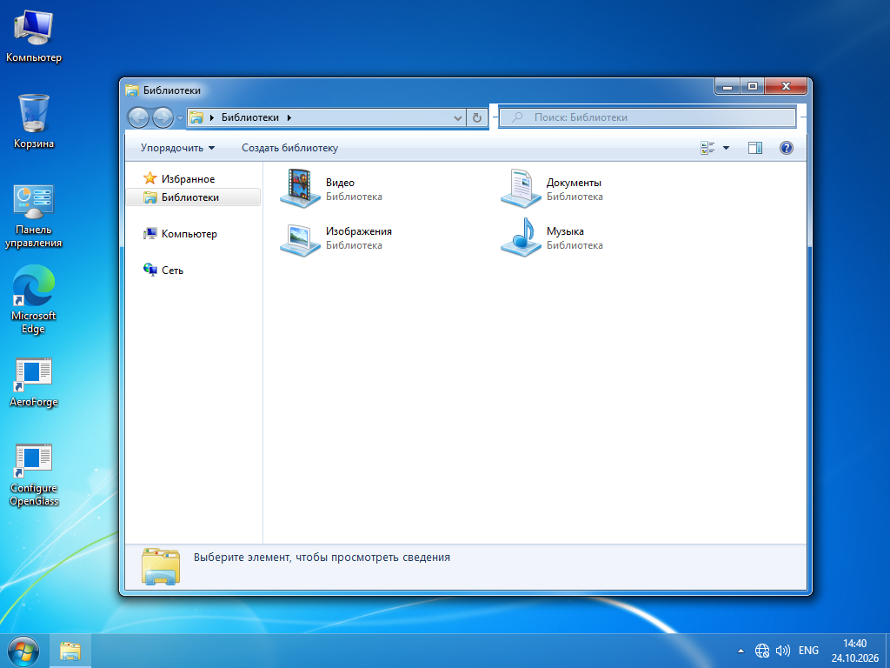
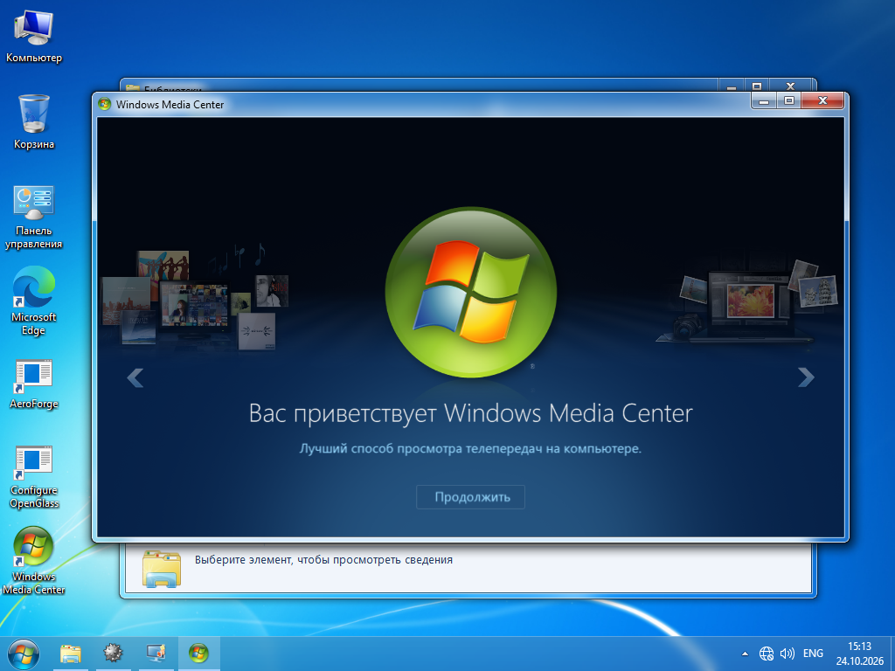

# WinMim: проверенная контрольная точка 24 октября 2026

Цель: Windows 10 LTSC 2021 x64 → Windows 7. Полное соответствие r8p пока не достигнуто. Все изменения ниже относятся только к основной ВМ AEROFORGE-LAB.

## Что изменилось

- Вместо двух библиотек подключён полный внешний пакет из 56 ресурсных DLL r8p build 1137 (67 231 056 байт). SHA-256 и отсутствие точки входа PE проверяются до применения. Перенаправление охватывает обычные процессы, а не только Explorer/Open-Shell.
- Отдельные журналируемые значения HKCU исправляют значки рабочего стола: используются оба приоритета Classes и Explorer\CLSID. Положительные индексы преобразуются в реальные идентификаторы ресурсов. На снимках после перезагрузки значки «Компьютер», «Корзина», панели управления и библиотек классические.
- В личной ВМ применяется неизменённая тема W7Aero-Redstone из пользовательского r8p. Тема и чужие ресурсы не включены в архивы исходников/сборки.
- Проводник после настоящей перезагрузки показывает «Упорядочить» вместо Ribbon. В дереве настоящее «Избранное» с Links, «Библиотеки», «Компьютер», «Сеть». Это не переименование Quick Access. Регистрация namespace и HubMode включены в журналы возврата.
- Пользователь реальным кликом подтвердил: нижний пункт контекстного меню панели задач открывает классические свойства, а не Параметры Windows 10.
- Наш координатор устанавливает исходные внешние пакеты игр Windows 7, Windows Desktop Gadgets и Windows Media Center. В мастере есть отдельные флажки; в разделе компонентов — состояние и удаление собственных установок. Существующие чужие установки не присваиваются.
- Сохраняются штатные деинсталляторы, их пути и SHA-256; изменённый после установки компонент автоматически не удаляется. Установка защищена от запуска на основном компьютере.
- Для Media Center исходный DVD Appx устанавливается с исходной лицензией штатным механизмом Windows. Изменённая MSI-обёртка DVD Player не запускается. После проверки реального наличия Appx передаётся документируемое свойство DVDPLAYER установщику WMC вместо создания фиктивной MSI-регистрации.

## Что действительно проверено

- 44 Core-теста прошли. Полный каталог содержит 31 модуль и 42 нативных DLL.
- Нативный тест извлечения значков: 47 доступных в LTSC библиотек, 0 несовпадений с внешними Win7-ресурсами; 9 исходных компонентов отсутствуют в этой редакции Windows.
- Тест namespace: создание, отказ удалить ключ с чужим значением, сохранение чужого значения, повторный корректный откат после удаления собственного тестового маркера.
- После реальной перезагрузки активна нужная тема, совпадают хеши выбранных модулей, автоматически запущен обычный пользовательский движок. Эксперимент повышения движка не применён; улучшение Проводника ему не приписывается.
- Установлены игры 3.1, гаджеты 2.0 и Media Center 8.9.1, коды установщиков 0. Настоящий «Сапёр» открыл выбор сложности; Media Center открыл русский экран приветствия.
- Пакет гаджетов содержит девять гаджетов, процесс Sidebar работает без обнаруженной ошибки приложения. Размещение гаджетов на рабочем столе пока не подтверждено.

## Что остаётся

Полный аудит поведения Пуска/панели/трея и системных переходов; точная доводка стекла и состояния кнопок; полный набор системных значков вне проверенного покрытия; экран входа/UAC; мультимедийное воспроизведение и функции WMC; отображение гаджетов и доступность их устаревших сетевых служб. Цикл штатного удаления и повторной установки игр завершён: Removed/Installed, оба exit 0. Возврат внешних программ выполняют их штатные деинсталляторы: точный побайтовый возврат всей системы не заявляется. DVD-зависимость пока остаётся после удаления WMC; автоматическое удаление зависимости ещё требуется реализовать.

## Снимки и отчёты

Отчёты: `evidence/full-icons-probe.json`, `evidence/namespace-smoke.json`, `evidence/full-seven-postboot.json`, `evidence/extras-inspect.json`. Полный старый список отличий сохраняется как история и не должен подменять текущие проверки.
